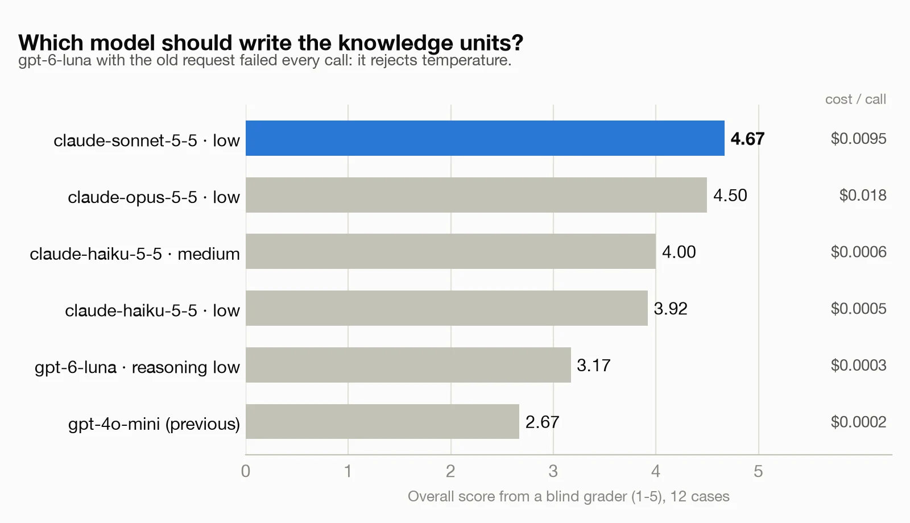
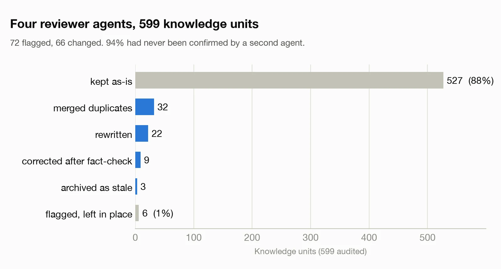

# Choosing the `reflect` model (2026-10)

`reflect` turns a session summary into candidate Knowledge Units. Until October 2026 it called
`gpt-4o-mini` through an OpenAI-compatible endpoint. OpenAI shuts that model down on 2027-01-14, so we
compared replacements before picking one. Production now uses `claude-sonnet-5-5` at low effort through
the Anthropic SDK with structured outputs.

## Method

- **Cases.** 12 session summaries built from 15 real KUs in our store: 8 prose recaps that bury one or
  two learnings among project-specific noise (one of them in German), 3 cases with nothing generalizable
  in them, and 2 in the terse tool-count + error-signal format the Stop hook sends (one of those is also
  an empty case). Each case lists the learnings a careful human expects (13 in total) and the noise that
  must not be extracted.
- **Same prompt text, different output mode.** Every model got the production system prompt and user
  template, and its output went through the same coercion into `ReflectCandidate`. OpenAI models got the
  production payload (free-form "respond with only a JSON array"); Claude models used
  `output_config.format` (JSON schema). The output mode therefore changed along with the model.
- **Blind grading.** A separate Claude agent saw the 12 inputs, the expected learnings and six anonymous
  outputs per case, with labels shuffled per case. It scored recall, bad candidates (noise, duplicates,
  facts not in the input), faithfulness, actionability, metadata and an overall 1–5.

## Results

| Config | Expected learnings found | Bad candidates | Overall (1–5) | Cost / call | Median latency |
|---|---|---|---|---|---|
| `gpt-4o-mini` (previous) | 10/13 | 10 | 2.67 | $0.0002 | 3.3 s |
| `gpt-6-luna`, previous payload | — every call HTTP 400 | — | — | — | — |
| `gpt-6-luna`, reasoning low | 12/13 | 5 | 3.17 | $0.0003 | 8.6 s |
| `claude-haiku-5-5`, effort low | 13/13 | 3 | 3.92 | $0.0005 | 4.7 s |
| `claude-haiku-5-5`, effort medium | 13/13 | 2 | 4.00 | $0.0006 | 5.1 s |
| **`claude-sonnet-5-5`, effort low** | **13/13** | **1** | **4.67** | $0.0095 | 6.6 s |
| `claude-opus-5-5`, effort low | 13/13 | 1 | 4.50 | $0.018 | 7.7 s |

The whole comparison cost about $0.36.

## What we learned

- **A model-name swap would have failed silently.** OpenAI's named replacement for `gpt-4o-mini` is a
  reasoning model and rejects `temperature` with a 400. `reflect` caught every LLM error, logged a warning
  and fell back to the heuristic extractor, so production would have kept "working" with much worse
  candidates and nothing watching that warning. Since this change, an HTTP 400/401/403/404 from the
  provider raises (a `ToolError` from the MCP tool, a 502 from `/hook/reflect`); only timeouts, 5xx,
  refusals and unparseable output fall back, they log at error level, the result carries a
  `fallback_reason`, and `status` reports `reflect_fallbacks` by reason.
- **The cheapest model was the worst value.** `gpt-4o-mini` produced terse, generic candidates that
  dropped product names and versions (which hurts later search) and let project noise through. At
  `reflect`'s volume, Sonnet's ~1 cent per call (about 47x `gpt-4o-mini`) stays under $30 a month even at
  100 calls a day.
- **Sonnet vs Haiku is closer than the overall score suggests.** Both found 13/13 expected learnings;
  Sonnet had 1 bad candidate against Haiku's 2–3, and won on the grader's holistic score. We picked
  Sonnet because the cost difference is small in absolute terms, not because the eval separates them
  cleanly.
- **Opus did not beat Sonnet** on this task, at twice the price.
- **Structured outputs removed a class of bugs.** The old code stripped markdown fences and rejected
  non-array JSON; with a JSON schema the response matches the schema, apart from refusals and truncated
  output, which are handled explicitly.
- **Two failure modes were shared by every model** and are now handled in the prompt: extracting the
  project's own bugs (a failing test, a null reference in a component) as if they were general traps, and
  answering in the language of the input. The shipped prompt was re-run on all 12 cases before release.

## Limits

12 cases, one run per configuration, one grader. The grader was a Claude model, so the gap between the
Claude and OpenAI rows may carry some self-preference; a second, non-Anthropic grader was planned and did
not run. Treat the gaps between neighbouring rows as indicative, not precise. The gap between
`gpt-4o-mini` and the Claude models is large enough that we acted on it, but it is not controlled for
that bias.

## Store audit, same week

The same week we audited 599 of the store's ~640 non-archived KUs with four Claude reviewer agents, each
taking a slice with an index of the whole store. The reviews, the fact-checks and the rewrites were
model work; a human decided what to apply. 527 (88%) were kept as-is, which is a model's judgment, not
ground truth. Of the 72 flagged: 32 duplicates merged (`flag(reason="duplicate")`), 26 rewrites attempted
and 22 applied (`propose` the fix, then `flag(reason="superseded")` the original), 10 suspected factual
errors checked against primary docs (9 corrected, 1 turned out to be right), 3 marked stale, and 1
duplicate pair deliberately kept because the two KUs complement each other. The 4 rewrites that could
not be applied failed because `propose` returned the original as a duplicate of its own fix, and there
is no tool to edit a KU in place. We could not tell which KUs came from `reflect` and which were
proposed directly, so the audit says nothing about `gpt-4o-mini` specifically.
Patterns worth fixing in the product rather than by hand:

- There is no edit path. A KU with a wrong fact can only be replaced by a new one, and a light fix is
  similar enough to the original that the duplicate check rejects it.
- Close paraphrases of the same trap get proposed weeks apart (12 near-identical zsh-vs-bash KUs), so
  duplicate detection at `propose` time misses rewordings.
- 94% of KUs sit at draft, confidence 0.5, zero confirmations, so status and confidence say little about
  quality; agents rarely call `confirm`.
- HTML entities (`&lt;`) appear in older summaries and break keyword search (the current server stores
  `<` as-is, so new KUs are not affected).
- Long KUs often bundle three to six separate traps under a summary that names one.
